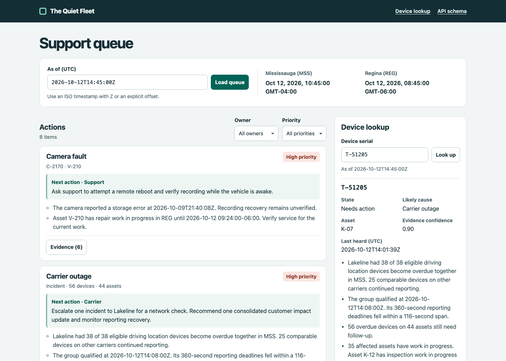

# The Quiet Fleet

## Install and start

On a fresh Ubuntu 24.04 machine, install Python 3.12 and its virtual environment support.

```bash
sudo apt-get update
sudo apt-get install -y python3.12 python3.12-venv
```

From the checkout root, install the pinned runtime and start the service.

```bash
python3.12 -m venv .venv
source .venv/bin/activate
python -m pip install -r requirements.txt
python -m quiet_fleet
```

The service listens on [localhost:8080](http://localhost:8080) with one worker and a fresh, empty telemetry store on every start. It loads six reference CSVs from `./data`. To use another directory, start with `QF_DATA_DIR="/absolute/path/to/reference-data" python -m quiet_fleet`. The six files are `assets.csv`, `devices.csv`, `schedule.csv`, `weather.csv`, `plan_changes.csv`, and `support_cases.csv`.

## Who it helps

A depot support agent reviews device issues before the 06:00 local shift and during active work. They use the queue to decide whether support should try a remote fix, a technician should inspect hardware, or a carrier should investigate an outage. They can cite the original event IDs and give customers one combined update during a shared outage.

The policy favors fewer false alarms. Parked trackers and sleeping cameras stay out of triage, carrier attribution requires comparison evidence, and a camera fault starts with a remote recovery check when appropriate. Direct faults and credible risk to scheduled work still surface. Each item names an owner and a recommended next step. [Support queue policy](docs/decisions.md#p07-support-queue) · [Diagnosis code](quiet_fleet/diagnosis.py) · [Incident rules](quiet_fleet/incidents.py) · [Threshold register](config/rules.json)

## Two-minute demo

With the service running against the bundled reference files, check readiness and the empty queue.

```bash
curl -fsS http://localhost:8080/health
curl -fsS 'http://localhost:8080/triage?at=2026-10-26T23:30:00Z'
```

Send one synthetic disconnect for the catalog tracker `T-59847`. This uses a demo event ID so its evidence is easy to find.

```bash
curl -fsS http://localhost:8080/ingest \
  -H 'Content-Type: application/json' --data @- <<'JSON'
{"events":[{"event_id":"demo-power","type":"power_disconnect","serial":"T-59847","device_time":"2026-10-26T18:10:00Z","received_at":"2026-10-26T18:10:01Z","payload":{}}]}
JSON
curl -fsS 'http://localhost:8080/devices/T-59847/status?at=2026-10-26T23:30:00Z'
curl -fsS 'http://localhost:8080/triage?at=2026-10-26T23:30:00Z'
```

The ingest response is `{"accepted":1}`. The device needs action for `power_loss`, and its queue item recommends that a technician inspect the tracker harness and restore external power. Both responses cite `demo-power`. Open the [optional dashboard](http://localhost:8080/) and load `2026-10-26T23:30:00Z` to inspect the same result. Restart the service for an empty store before any official replay.

## Optional dashboard

The [dashboard](http://localhost:8080/) is an optional, read-only view of the API. It opens at the fixed end-of-history checkpoint `2026-10-31T23:59:00Z` and shows the same instant in both depot time zones. Choose a checkpoint, narrow the visible actions by owner or priority, and use device lookup or the evidence drawer to inspect the original event IDs. All page assets ship with the Python service.



## API examples

| Endpoint | Use |
| --- | --- |
| `GET /health` | Returns `{"status":"ok"}` once the local store and references are ready. |
| `POST /ingest` | Accepts up to 5,000 events in `{"events":[...]}`. `accepted` includes valid retries and well-formed unused types. Malformed entries and conflicting ID reuses are excluded. |
| `GET /devices/{serial}/status?at=...` | Returns state, cause, confidence, last device contact, reasons and original evidence IDs. |
| `GET /triage?at=...` | Returns prioritized actions and grouped incidents with a single queue item per serial. |

Use an ISO 8601 timestamp with `Z` or an explicit offset for `at`. Invalid timestamps or batch envelopes return HTTP 400. Unknown serials return 404. The full schema is available at [local OpenAPI](http://localhost:8080/openapi.json). [Vendor API contract](vendor/quiet-fleet/docs/CONTRACT.md)

This is the actual status for `C-2179` after the sample replay.

```json
{
  "serial": "C-2179",
  "asset_id": "V-140",
  "at": "2026-10-20T15:50:00Z",
  "state": "quiet_expected",
  "likely_cause": "sleeping_by_design",
  "confidence": 1.0,
  "last_heard_at": "2026-10-20T15:12:05Z",
  "reasons": ["The camera reported sleeping after the vehicle switched ignition off."],
  "evidence": ["e91993356", "e61890675", "e40114819"]
}
```

At the same checkpoint, one of the returned `/triage` items recommends a remote recovery check ahead of scheduled work.

```json
{
  "item_id": "device-7a6caa55cede8126ea41c3f8",
  "kind": "device",
  "serials": ["C-2957"],
  "asset_ids": ["V-133"],
  "likely_cause": "camera_fault",
  "who_acts": "support",
  "next_action": "Ask support to attempt a remote reboot and verify recording while the vehicle is awake.",
  "priority": "high",
  "reasons": [
    "The camera reported a storage error at 2026-10-20T15:10:00Z. Recording recovery remains unverified.",
    "Asset V-133 is scheduled for service call work in MSS at 2026-10-20 11:59:00-04:00. Verify service before the job starts."
  ],
  "evidence": ["e47594389", "e45708091", "e53093306"]
}
```

## How decisions are made

1. **Ingest.** Normalize payloads and clocks, deduplicate event IDs and semantic retries, and retain original receipts in temporary SQLite. [Ingestion and time model](docs/ingestion.md)
2. **Diagnose.** Apply the receipt cutoff at the requested instant, then order eligible observations by device time. Use effective asset assignment, reporting expectations, and cause-specific recovery to evaluate devices. [Decision log](docs/decisions.md)
3. **Prioritize.** Use the same diagnosis for status and triage. Group corroborated carrier gaps and assign actions based on current work, the next depot-local shift, and evidence. [Support policy](docs/decisions.md#p07-support-queue)

The October 4–24 development window and October 25–31 validation window informed the 6-minute driving position, 10-minute awake recording, and 26-hour A/BX overdue thresholds. The supplied 4-hour-30-minute parked heartbeat deadline and 15-minute camera sleep transition are separate rules. BX decoding matched all three portal anchors, and replay verified 313 envelopes with 308 distinct observations. The wire low-battery flag drives BX technician follow-up. [Calibration and provenance](docs/calibration.md) · [BX decoding proof](docs/bx-decoding.md)

The two-hour preparation window and BX battery recovery threshold are provisional. Seasonal downtime suppression awaits operating approval and dates. The service uses Toronto and Regina time zones for local deadlines. [Open operational questions](docs/decisions.md#open-operational-questions)

## Release verification

From the checkout root with the pinned runtime installed and port 8080 free, run both vendor checks on separate empty stores, then run the offline restart check. The vendor checks need `data/telemetry/*.jsonl` from the original local pack. The service and offline smoke check start from six CSVs alone.

```bash
python scripts/release_check.py --data "$PWD/data" --persona support
```

For an individual check, pass `preflight`, `practice`, or `offline` to `scripts/verify.py`.

```bash
python scripts/verify.py offline --data "$PWD/data"
```

| Option | Meaning |
| --- | --- |
| `--data DIR` | Six reference CSVs. The vendor checks also use the original `telemetry/*.jsonl` under this directory. |
| `--persona support` | Selects the support practice checks. This is the default. |
| `--out DIR` | Report root, defaulting to `reports/`. Every check creates a fresh run directory. |
| `--port PORT` | Loopback port for the verifier. Defaults to 8080 and the documented entrypoint. A different port runs the same application with one Uvicorn worker. |
| `--startup-timeout SECONDS` | Readiness deadline, defaulting to 15 seconds. |
| `--exam-timeout SECONDS` | Vendor invocation deadline, defaulting to 900 seconds. |

The verifier records exit codes, logs, request timings and checkpoint responses. An ingest request reaching 10 seconds fails the check. The final macOS audit passed preflight, practice, and the offline restart. The Ubuntu 24.04 run with `--network none` remains open. [Final checks, measurements, and Ubuntu commands](reports/release-readiness.md)

```bash
python -m pip install -r requirements-dev.txt
python -m unittest discover -s tests -v
```

The final suite passed 96 tests on Python 3.12.2. [Latest verification](reports/release-readiness.md)

[Requirements and verification](docs/requirements.md) · [Project status](planning/STATUS.md) · [AI usage](docs/ai-usage.md) · [END checkpoint evidence](reports/end-state-top-three.json)
